# itsrealkaran

Compact is one language. Regular is the list. Wide splits the lead language out.

## classic

**languages** · classic · mini

`https://github.com/itsrealkaran/languages?username=itsrealkaran&theme=classic&size=mini`

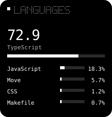

**languages** · classic · compact

`https://github.com/itsrealkaran/languages?username=itsrealkaran&theme=classic&size=compact`

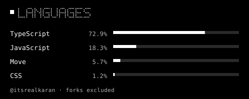

**languages** · classic · regular

`https://github.com/itsrealkaran/languages?username=itsrealkaran&theme=classic&size=regular`

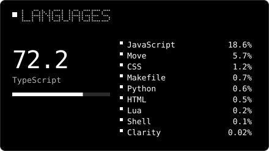

**languages** · classic · wide

`https://github.com/itsrealkaran/languages?username=itsrealkaran&theme=classic&size=wide`

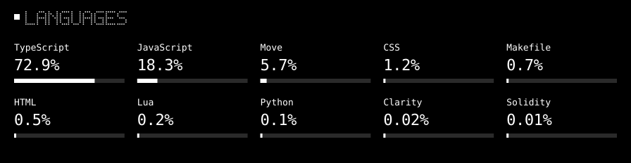

## classic-r

**languages** · classic-r · mini

`https://github.com/itsrealkaran/languages?username=itsrealkaran&theme=classic-r&size=mini`

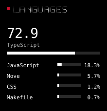

**languages** · classic-r · compact

`https://github.com/itsrealkaran/languages?username=itsrealkaran&theme=classic-r&size=compact`

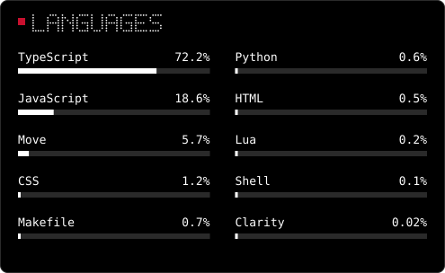

**languages** · classic-r · regular

`https://github.com/itsrealkaran/languages?username=itsrealkaran&theme=classic-r&size=regular`

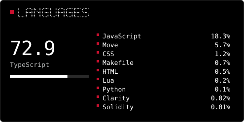

**languages** · classic-r · wide

`https://github.com/itsrealkaran/languages?username=itsrealkaran&theme=classic-r&size=wide`

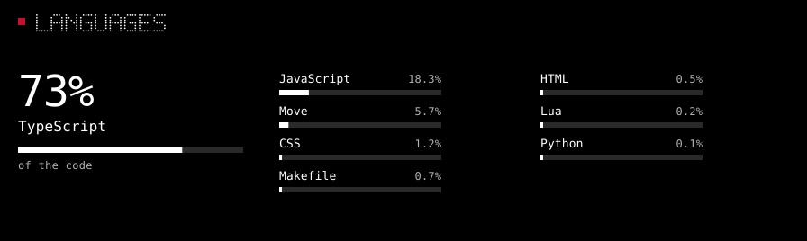

## white

**languages** · white · mini

`https://github.com/itsrealkaran/languages?username=itsrealkaran&theme=white&size=mini`

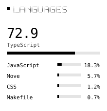

**languages** · white · compact

`https://github.com/itsrealkaran/languages?username=itsrealkaran&theme=white&size=compact`

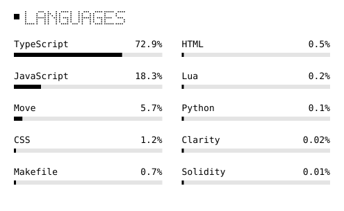

**languages** · white · regular

`https://github.com/itsrealkaran/languages?username=itsrealkaran&theme=white&size=regular`

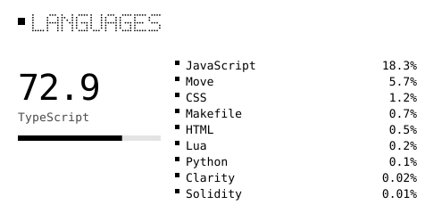

**languages** · white · wide

`https://github.com/itsrealkaran/languages?username=itsrealkaran&theme=white&size=wide`

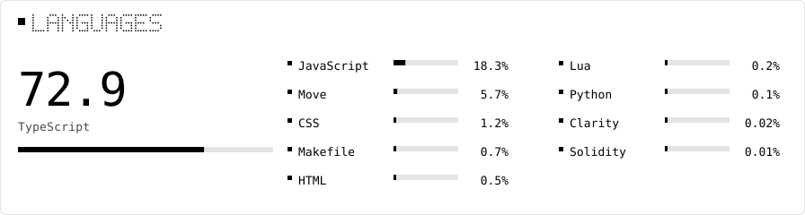

## white-r

**languages** · white-r · mini

`https://github.com/itsrealkaran/languages?username=itsrealkaran&theme=white-r&size=mini`

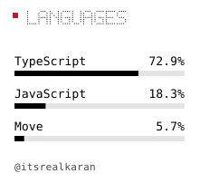

**languages** · white-r · compact

`https://github.com/itsrealkaran/languages?username=itsrealkaran&theme=white-r&size=compact`

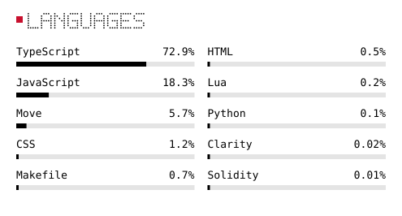

**languages** · white-r · regular

`https://github.com/itsrealkaran/languages?username=itsrealkaran&theme=white-r&size=regular`

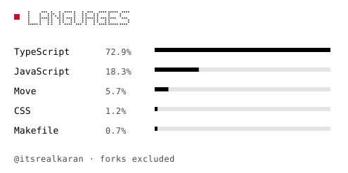

**languages** · white-r · wide

`https://github.com/itsrealkaran/languages?username=itsrealkaran&theme=white-r&size=wide`

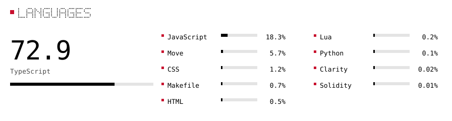

## light

**languages** · light · mini

`https://github.com/itsrealkaran/languages?username=itsrealkaran&theme=light&size=mini`

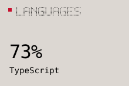

**languages** · light · compact

`https://github.com/itsrealkaran/languages?username=itsrealkaran&theme=light&size=compact`

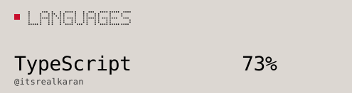

**languages** · light · regular

`https://github.com/itsrealkaran/languages?username=itsrealkaran&theme=light&size=regular`

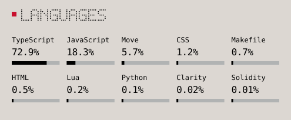

**languages** · light · wide

`https://github.com/itsrealkaran/languages?username=itsrealkaran&theme=light&size=wide`

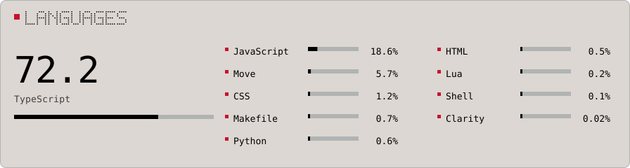

## red

**languages** · red · mini

`https://github.com/itsrealkaran/languages?username=itsrealkaran&theme=red&size=mini`

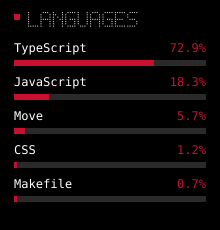

**languages** · red · compact

`https://github.com/itsrealkaran/languages?username=itsrealkaran&theme=red&size=compact`

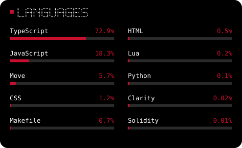

**languages** · red · regular

`https://github.com/itsrealkaran/languages?username=itsrealkaran&theme=red&size=regular`

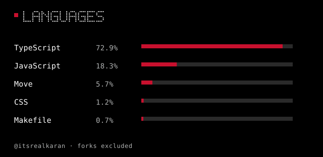

**languages** · red · wide

`https://github.com/itsrealkaran/languages?username=itsrealkaran&theme=red&size=wide`

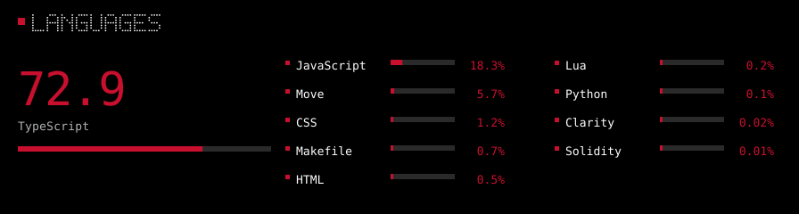

## blue

**languages** · blue · mini

`https://github.com/itsrealkaran/languages?username=itsrealkaran&theme=blue&size=mini`

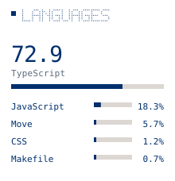

**languages** · blue · compact

`https://github.com/itsrealkaran/languages?username=itsrealkaran&theme=blue&size=compact`

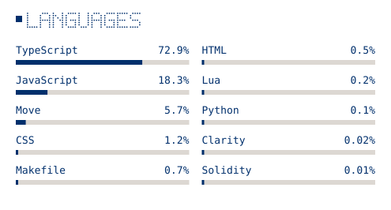

**languages** · blue · regular

`https://github.com/itsrealkaran/languages?username=itsrealkaran&theme=blue&size=regular`

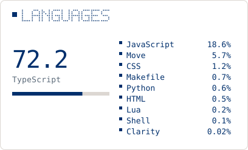

**languages** · blue · wide

`https://github.com/itsrealkaran/languages?username=itsrealkaran&theme=blue&size=wide`

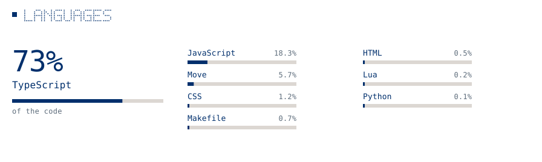

## yellow

**languages** · yellow · mini

`https://github.com/itsrealkaran/languages?username=itsrealkaran&theme=yellow&size=mini`

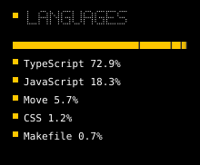

**languages** · yellow · compact

`https://github.com/itsrealkaran/languages?username=itsrealkaran&theme=yellow&size=compact`

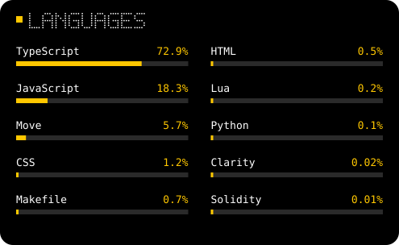

**languages** · yellow · regular

`https://github.com/itsrealkaran/languages?username=itsrealkaran&theme=yellow&size=regular`

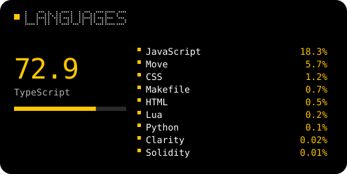

**languages** · yellow · wide

`https://github.com/itsrealkaran/languages?username=itsrealkaran&theme=yellow&size=wide`

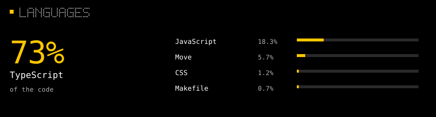

